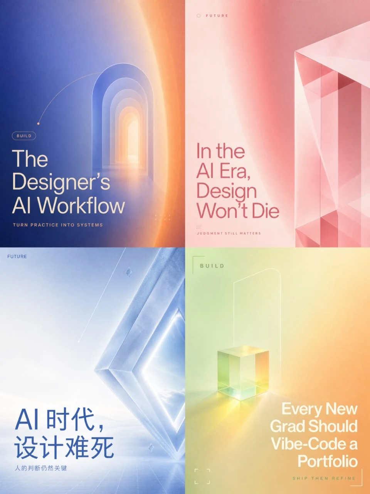
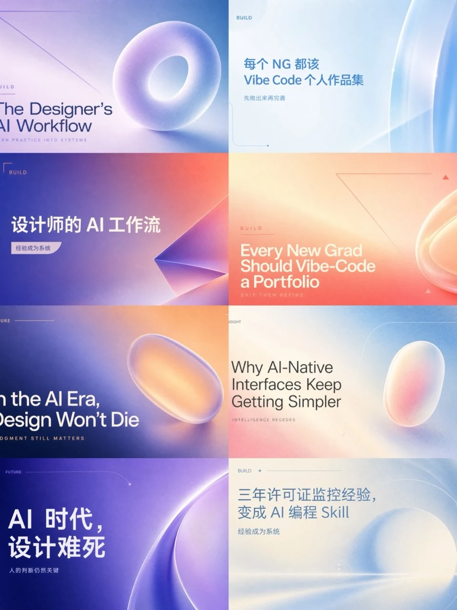

# Retro Futuristic Cover

A ChatGPT/Codex Skill that turns an article, draft, topic, or sentence into one finished retro-futuristic editorial social-media cover.

> **V2 alpha status:** `main` remains the stable V1 release. The `next` branch contains the carrier-aware V2 visual system and is intentionally pre-release while its composition grammar is being validated across controlled visual regression batches. Do not treat `next` as production-ready yet.

The Skill preserves the semantic identity of an existing article title, rephrases it only when needed for cover readability, and generates a polished cover with seamless soft gradients, diffuse light, fine grain, readable typography, generous negative space, and restrained geometric accents. When no title exists, it derives a faithful title from the source.

## Examples

Generated covers across portrait and landscape formats, Chinese and English typography, and hero-object and atmospheric compositions.

<p align="center">
  
  
  
</p>

## Visual direction

- Seamless, continuous soft gradients rather than isolated color halos
- Diffuse light and fine frosted grain
- Adaptive tonal regimes and monochromatic, analogous, duotone, or tri-color harmony modes
- Controlled coral roles so warm coral may lead, accent, or disappear across outputs
- One dominant, highly readable headline
- Source-title fidelity with locked subject, use-case, promise, meaningful-count, audience, and proper-noun anchors
- Content-aware title modes for titled articles, utility/list content, and thesis-led essays
- Minimal category label and micro-subtitle
- Small randomized stars, triangles, rhombi, dots, rings, or corner brackets
- Rotating arches, portals, flowing chromatic shapes, perspective planes, curved surfaces, and flattened orbs
- An editorial alignment system connecting labels, type, structural lines, and micro-accents
- Typography that rotates between restrained editorial serif, clean sans, and neutral grotesk
- Three controlled CJK sans modes—neo-grotesk, soft humanist, and structural sans—with Song/Ming and generic heavy system Heiti explicitly rejected
- A persistent coordinated design deck that rotates palettes, gradient flow, focal mode, hero or atmospheric form, type mode, labels, and accents while excluding recent selections
- Readable article-cover typography: balanced three-line X headlines, regular-to-medium optical weight, relaxed display leading, and a roughly 28–34% tight visible-glyph height for longer landscape titles
- A hard-compliance gate followed by a poster-integration critique of the actual rendered pixels
- Targeted local editing for isolated flaws and fresh regeneration for structural failures
- At most three private versions, with only the final passing cover shown
- Deterministic verification of output format, dimensions, and aspect ratio
- No cyberpunk neon, dense collage, experimental type, or text-heavy layouts
- No generic “high-contrast Didone + glowing planet + orbit + sparkle” AI-poster combination

## V2 alpha architecture

The `next` branch expands the Skill from a cover recipe into a catalog-first visual system:

- 5 carrier contracts and carrier-specific text inventories
- 8 Composition Contracts with explicit title zones, object slots, collision rules, crop behavior, release zones, and thumbnail tests
- 4 subject assemblies and 18 composition operators
- 3 subject origins: abstract form, archive artifact, and speculative object
- 13 object families and 4 retro-future speculative morphologies
- conditional archive-computer screen states
- machine-readable compatibility rules, manifest schema, selector evals, and proof-image validation

The current V2 readiness work is visual rather than catalog expansion: controlled composition isolation, assembly and morphology coverage, gradient-topology stress testing, and a representative golden regression set.

## Platform presets

| Platform | Canvas |
|---|---:|
| Xiaohongshu cover | 1080 × 1440 px (3:4) |
| X post landscape | 1200 × 675 px (16:9) |
| X post square | 1080 × 1080 px (1:1) |
| X banner | 1500 × 500 px (3:1) |

A generic X post request uses the landscape preset. Square and banner layouts are selected only when explicitly requested, and each format is recomposed rather than cropped or stretched.

## Requirements

- **Recommended:** Codex with an image-generation tool enabled.
- **Alternative:** another agent or image-generation model that can accept a local style-reference image, follow exact text constraints, and save the result as a local image file.
- Python 3.9 or newer for the bundled recipe selector and image verifier.

Claude Code is not recommended as the default environment for this Skill because it does not provide the image-generation workflow the Skill depends on by itself. Use it only when it is connected to a compatible external image-generation tool that can accept the bundled reference image and preserve the three required text elements.

## Install

For Codex, clone the repository into your personal Skills directory:

```bash
mkdir -p ~/.codex/skills
git clone https://github.com/mengxuebi-mush/retro-futuristic-cover.git ~/.codex/skills/retro-futuristic-cover
```

For another compatible agent environment, copy or clone the repository into that environment's Skills directory. Start a new task after installation so the Skill is loaded.

To inspect the V2 alpha explicitly, clone the `next` branch into a separate test location rather than replacing a stable V1 installation:

```bash
git clone --branch next https://github.com/mengxuebi-mush/retro-futuristic-cover.git retro-futuristic-cover-v2-alpha
```

## Development and validation

Use `next` for V2 alpha work and keep `main` releasable. Run the complete dependency-free validation set before committing:

```bash
python3 scripts/validate_catalog_v2.py
python3 scripts/validate_evals_v2.py
python3 scripts/verify_examples.py
```

The same checks run in GitHub Actions. Visual proofs still require pixel-level review for exact text inventory, title-first hierarchy, Composition Contract fidelity, subject identity or function, and thumbnail behavior.

## Use

Provide an article, topic, draft, or sentence and ask for a social-media cover. For example:

```text
Use Retro Futuristic Cover to turn this article into an X post cover.
```

The Skill generates one final cover by default. It privately critiques and improves the result, and does not expose intermediate images, prompts, or internal verdicts unless requested.

## License

Released under the [MIT License](LICENSE).
